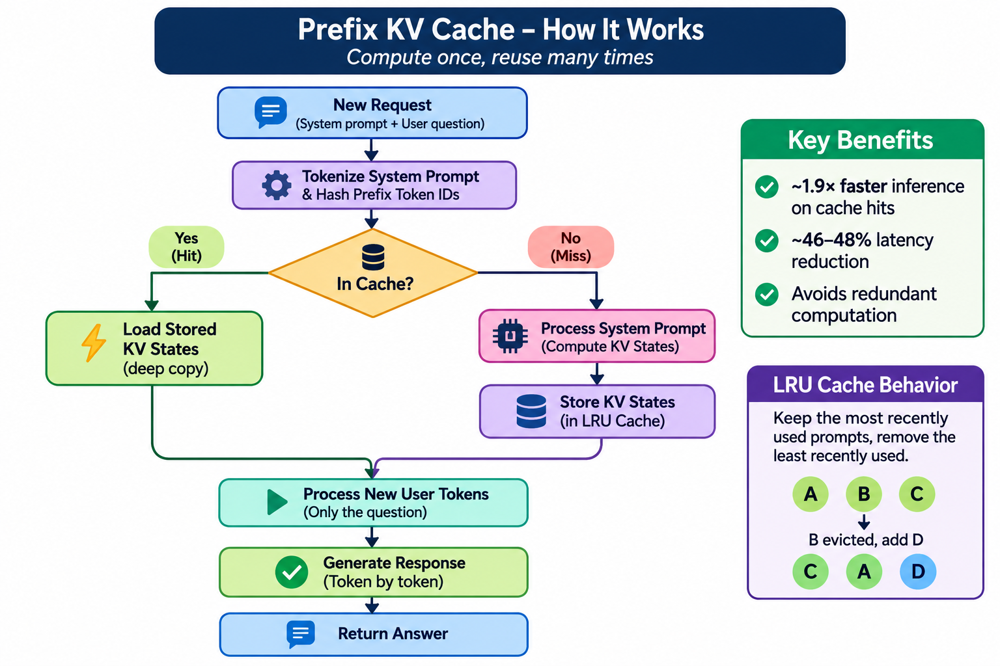
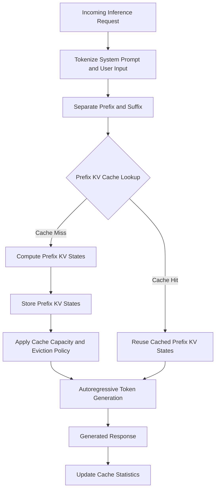

# Prefix KV Cache

### AI Systems Engineering | LLM Inference Optimization

A memory-aware Prefix Key-Value (KV) Cache designed to optimize autoregressive Large Language Model (LLM) inference by reusing previously computed prefix attention states.

This project explores how caching, prefix reuse, pinned cache entries, memory-aware eviction, and GPU memory management can reduce repeated computation during LLM inference.

\<p align="center">   \ \</p>

---

## Overview

Large Language Models use autoregressive generation. During inference, the model processes input tokens and maintains Key-Value (KV) tensors for attention layers.

When multiple requests share the same system prompt or prefix, repeatedly computing the same prefix states introduces unnecessary computation and latency.

**Prefix KV Cache addresses this problem by reusing previously computed prefix KV states.**

The project implements a caching system that supports:

- Reusable prefix KV states
- Pinned prefixes for frequently reused prompts
- LRU-based cache eviction
- Memory-aware cache capacity management
- Cache statistics and performance monitoring
- Concurrent inference testing
- GPU memory and latency benchmarking

The main goal is to explore practical inference optimization techniques from an AI systems perspective.

## Architecture

### High-level inference flow



### Main components

| Component                | Responsibility                                                      |
| ------------------------ | ------------------------------------------------------------------- |
| `PrefixKVCache`          | Stores and retrieves reusable prefix KV states                      |
| `CachedGenerator`        | Integrates cache reuse with model generation                        |
| Pinned Prefix Management | Protects selected frequently reused prefixes from ordinary eviction |
| LRU Eviction             | Removes less recently used ordinary cache entries                   |
| Memory-Aware Management  | Tracks cache memory usage and capacity                              |
| Benchmark Suite          | Measures latency, cache performance, and memory scaling             |
| Streamlit Dashboard      | Provides an interactive interface for inference and monitoring      |

### Cache operation

**1. Prefix identification**

The system separates reusable prefix tokens from request-specific suffix tokens.

**2. Cache lookup**

The cache checks whether KV states for the requested prefix are already available.

**3. Cache hit**

If the prefix exists, previously computed KV states are reused rather than recomputed.

**4. Cache miss**

If the prefix is unavailable, the model computes its KV states and the cache can store them for subsequent requests.

**5. Cache management**

Pinned entries are protected from ordinary LRU eviction. Memory and capacity limits help control cache growth.

**6. Generation**

The model continues autoregressive generation using the available prefix states and request-specific input.

---

## Key Features

### 1. Prefix KV Caching

- Reuses computed attention KV states.
- Reduces repeated prefix computation for shared-prefix requests.
- Supports cache lookup and retrieval.
- Tracks cache hits, misses, and hit rate.

### 2. Pinned Prefix Caching

Frequently reused prefixes can be pinned to protect them from ordinary LRU eviction.

This is useful for workloads where multiple requests share common system prompts or context prefixes.

### 3. LRU Cache Eviction

The cache supports least-recently-used eviction for ordinary entries.

This allows less frequently accessed entries to be removed when cache capacity is reached while preserving pinned entries under the tested conditions.

### 4. Memory-Aware Cache Management

The implementation tracks cache memory usage and supports a configurable memory capacity.

Available statistics include:

- Total cache entries
- Pinned entries
- Ordinary entries
- Cache hits and misses
- Eviction count
- Cache hit rate
- Memory consumption
- Pinned memory consumption
- Memory utilization

**Note:** Cache memory statistics describe retained KV cache tensors, not total GPU memory usage. Model weights, activations, temporary tensors, and CUDA allocator overhead are separate.

### 5. Concurrent Inference Testing

The project includes tests that evaluate concurrent generation requests sharing a pinned prefix and compare their outputs with sequential reference outputs.

### 6. Interactive Dashboard

A Streamlit application provides an interface for exploring:

- Inference experiments
- Prefix management
- Cache statistics
- Cached versus uncached generation
- Benchmark comparisons
- GPU monitoring

The dashboard is a demonstration interface for the underlying inference system.

---

## Technology Stack

| Technology                | Purpose                               |
| ------------------------- | ------------------------------------- |
| Python                    | Core implementation                   |
| PyTorch                   | Tensor operations and model inference |
| CUDA                      | GPU acceleration                      |
| Hugging Face Transformers | Pretrained language models            |
| GPT-2                     | Benchmark model                       |
| Streamlit                 | Interactive dashboard                 |
| Pandas                    | Data handling                         |
| Pytest                    | Testing                               |

## Project Structure

```text
prefix-kv-cache/
│
├── prefix_kv_cache/
│   ├── __init__.py
│   ├── cache.py
│   └── engine.py
│
├── tests/
│   └── test_persistent_cache.py
│
├── app.py
│
├── benchmark.py
├── benchmark_lru_vs_pinned.py
├── benchmark_memory_scaling.py
├── benchmark_pinned_prefix.py
├── benchmark_prefix_lengths.py
├── benchmark_shared_prefix.py
│
├── inspect_dynamic_cache.py
│
├── test_cache_thread_safety.py
├── test_concurrent_requests.py
├── test_memory_aware_cache.py
├── test_multiple_pinned_prefixes.py
├── test_pinned_cache.py
├── test_pinned_prefix_memory.py
├── test_real_model_memory.py
│
├── prefix_kv_cache_architecture.png
├── prefix_kv_cache_results.xlsx
│
├── requirements.txt
├── README.md
└── .gitignore
```

## Installation

### Requirements

- Python 3.10 or newer recommended
- PyTorch 2.6 or newer
- Hugging Face Transformers
- NVIDIA GPU with CUDA support recommended for GPU benchmarks

CPU execution may be possible depending on the model and workload. GPU benchmark numbers should not be expected on CPU.

### 1. Clone the repository

```bash
git clone https://github.com/ManishaChindam0309/prefix-kv-cache.git
cd prefix-kv-cache
```

### 2. Create a virtual environment

Windows PowerShell:

```powershell
python -m venv .venv
.venv\Scripts\Activate.ps1
```

### 3. Install PyTorch

Install a PyTorch build compatible with your CUDA environment using the official installation selector:

[https://pytorch.org/get-started/locally/](https://pytorch.org/get-started/locally/)

### 4. Install project dependencies

```bash
pip install -r requirements.txt
```

### 5. Verify installation

```bash
python -c "import torch; print('PyTorch:', torch.__version__); print('CUDA available:', torch.cuda.is_available())"
```

---

## Usage

### Basic cache initialization

```python
from prefix_kv_cache import PrefixKVCache, CachedGenerator

# Initialize the cache
cache = PrefixKVCache(
    max_entries=50,
    max_memory_mb=512
)
```

### Initialize a language model

```python
import torch
from transformers import AutoTokenizer, AutoModelForCausalLM

model_name = "gpt2"

tokenizer = AutoTokenizer.from_pretrained(model_name)

model = AutoModelForCausalLM.from_pretrained(model_name)

device = "cuda" if torch.cuda.is_available() else "cpu"
model = model.to(device)

# Connect the model to the cache
generator = CachedGenerator(
    model,
    tokenizer=tokenizer,
    cache=cache
)
```

### Generate using a reusable system prompt

```python
system_prompt = "You are a helpful AI assistant."

user_message = "Explain how KV caching works."

response = generator.generate(
    system_prompt,
    user_message,
    max_new_tokens=64,
    use_cache=True
)
```

### Pin a frequently reused prefix

```python
generator.pin_system_prompt(
    "You are a helpful AI assistant."
)
```

Pinned prefixes are protected from ordinary cache eviction under the cache's tested behavior.

---

## Performance Benchmarks

Experiments were conducted using GPT-2 on an NVIDIA RTX 2050 GPU.

The measurements below are from controlled benchmark workloads. They are not production-serving guarantees.

### 1. LRU vs Pinned Prefix Cache

Natural-language workload:

- 46-token frequently reused system prefix
- Four competing prompts
- 48 requests per trial
- Three trials

| Cache Strategy      | Mean Latency | Improvement vs No Cache |
| ------------------- | -----------: | ----------------------: |
| No Cache            |    238.90 ms |                Baseline |
| LRU Cache           |    168.41 ms |                  29.51% |
| Pinned Prefix Cache |    157.71 ms |                  33.98% |

Pinned prefix caching achieved approximately **1.51× speedup** over the no-cache baseline.

Including average prefix-pinning setup time, the latency reduction was 33.60%.

### 2. Pinned Prefix Performance by Prefix Length

Dedicated pinned-prefix benchmark results:

| Prefix Length | Standard Latency | Pinned Latency | Speedup | Latency Reduction |
| ------------: | ---------------: | -------------: | ------: | ----------------: |
|    512 tokens |        155.05 ms |       93.40 ms |   1.66× |            39.76% |
|    768 tokens |        180.20 ms |       98.57 ms |   1.83× |            45.30% |

The results indicate that prefix reuse can provide greater benefits for longer shared prefixes in the tested workload.

### 3. Shared Prefix Benchmark

Ten suffix questions shared a common prefix across ten rounds, giving 100 measured requests per benchmark run.

| Prefix Length | Standard Mean | Cached Mean | Speedup | Latency Reduction |
| ------------: | ------------: | ----------: | ------: | ----------------: |
|    512 tokens |     155.82 ms |    98.67 ms |   1.58× |            36.68% |
|    768 tokens |     177.09 ms |    96.81 ms |   1.83× |            45.34% |

These figures are averages across three independent pretrained GPT-2 runs at each prefix length.

### 4. GPU Memory Scaling

Measured retained incremental KV cache memory:

| Prefix Length | Incremental Retained Memory |
| ------------: | --------------------------: |
|     32 tokens |                    2.25 MiB |
|     64 tokens |                    4.50 MiB |
|    128 tokens |                    9.00 MiB |
|    256 tokens |                   18.00 MiB |
|    512 tokens |                   37.00 MiB |

Five pinned prefixes across the tested lengths used a total of 70.75 MiB of additional retained allocated GPU memory.

These measurements are specific to the tested GPT-2 configuration and hardware.

### Benchmark Interpretation

- Longer shared prefixes showed stronger benefits in the dedicated prefix-length experiments.
- Pinned prefixes improved reuse for frequently accessed prefixes in the tested workloads.
- Short prefixes do not necessarily benefit from pinning because cache-management and copying overhead can outweigh the saved computation.
- Prefix-pinning setup time matters for short-lived workloads.
- GPU timing can vary due to device utilization, warmup, and memory conditions.

### Correctness

The benchmark and test suite includes checks for:

- Cached and uncached output equivalence.
- Prefix pinning and unpinning behavior.
- LRU eviction.
- Multiple pinned prefixes.
- Memory-aware cache behavior.
- Concurrent generation.
- Cache thread-safety behavior.
- Persistent cache behavior.

The correctness claims apply to the tested configurations and workloads.

---

## Running the Dashboard

Start the interactive Streamlit application:

```bash
streamlit run app.py
```

The application provides the following sections:

| Dashboard Section | Purpose                               |
| ----------------- | ------------------------------------- |
| Inference Lab     | Run inference experiments             |
| Prefix Vault      | Manage reusable system prefixes       |
| Benchmark Arena   | Compare cached and uncached inference |
| GPU Monitor       | Observe GPU and cache metrics         |

---

## Running Tests

Run the test suite using:

```bash
pytest -v
```

Individual tests can also be run:

```bash
python test_cache_thread_safety.py
python test_concurrent_requests.py
python test_memory_aware_cache.py
python test_multiple_pinned_prefixes.py
python test_pinned_cache.py
python test_pinned_prefix_memory.py
python test_real_model_memory.py
```

Some tests and benchmarks use CUDA and pretrained model downloads. Make sure the required model and GPU environment are available before running them.

---

## Future Improvements

Potential directions for further development:

- Benchmark with larger LLM architectures.
- Evaluate longer and more realistic production-style prompts.
- Improve KV tensor memory efficiency.
- Explore quantized KV cache storage.
- Investigate prefix matching and partial-prefix reuse.
- Evaluate multi-GPU and distributed inference.
- Add workload-aware cache replacement policies.
- Benchmark time-to-first-token and end-to-end generation throughput.
- Compare against optimized inference engines.

---

## Limitations

- Current benchmark results are based primarily on GPT-2.
- Results depend on model architecture, prefix length, hardware, and workload.
- Synthetic and controlled prefix workloads do not represent all real-world serving patterns.
- Cache memory accounting does not include total model memory or all CUDA overhead.
- The project is an experimental inference optimization implementation, not a production-ready distributed LLM serving platform.

---

## Author

**Manisha Chindam**

AI Systems Engineering | LLM Inference Optimization

GitHub: [https://github.com/ManishaChindam0309](https://github.com/ManishaChindam0309)

---

## License

No license has been added to this repository yet. Add a license file before describing the project as open source or specifying reuse permissions.
